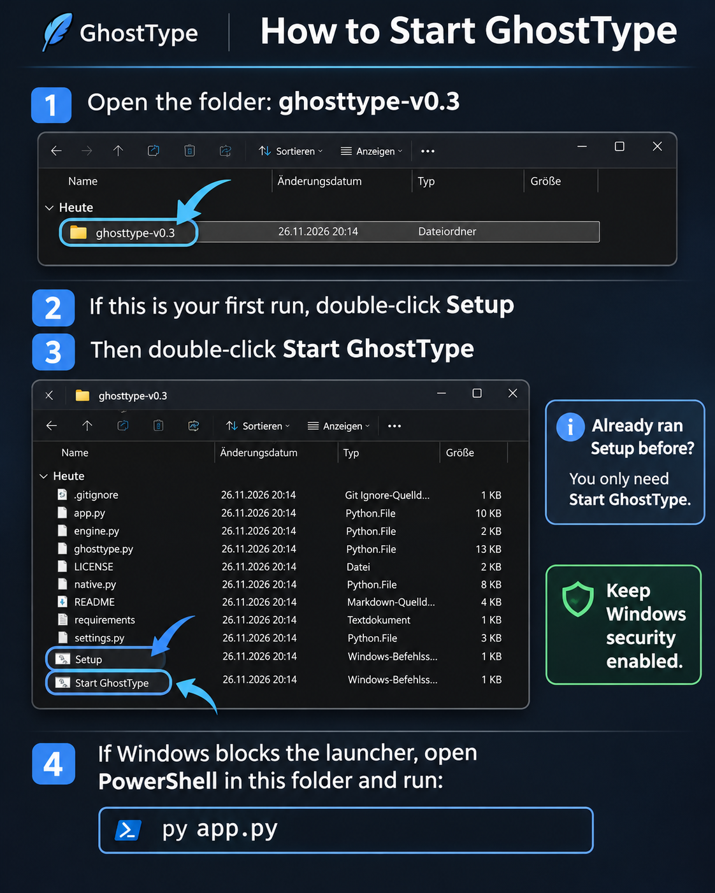
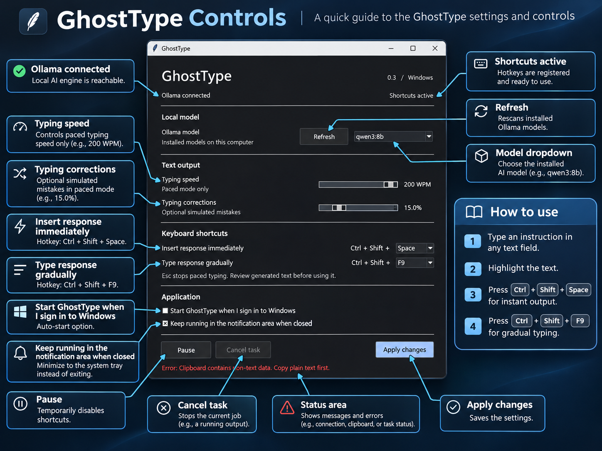

# GhostType

**Your AI. Right where you type.**

GhostType is a free, open-source, local-first AI assistant for Windows that brings AI directly into your existing applications without switching windows or opening a chatbot.

Select an instruction, press a keyboard shortcut, and GhostType replaces your text with an AI-generated response.

**Free · Open Source · Local AI · No Account Required**

## Features

- Local AI inference through Ollama
- Instant text replacement
- Adjustable character-by-character text output
- Automatic detection of installed AI models
- Configurable keyboard shortcuts
- Desktop settings interface
- System-tray integration
- Optional automatic Windows startup
- No mandatory subscriptions or cloud API fees
- No prompt or response logs

## Download

**[Download GhostType v0.3.0](https://github.com/3lis171/GhostType/releases/tag/v0.3.0)**

GhostType is currently an early alpha. Feedback, bug reports and contributions are welcome.

## Installation

### 1. Install the prerequisites

- [Python](https://www.python.org/downloads/) with Tcl/Tk support
- [Ollama](https://ollama.com/download)
- Windows 10 or 11

### 2. Install a local AI model

Open PowerShell and run:

```powershell
ollama pull qwen2.5:7b
```

For computers with limited resources, a smaller model such as `qwen2.5:1.5b` may be more suitable.

If you already have a compatible local Ollama model installed, you can use that instead. Model licenses are separate from GhostType's software license.

### 3. Launch GhostType

1. Download the source code ZIP from the Releases page.
2. Extract the archive.
3. Open the `ghosttype-v0.3` folder.
4. Double-click `Setup.cmd` to install the dependencies.
5. Double-click `Start GhostType.cmd`.
6. Select your installed AI model.
7. Click **Apply changes**.

Make sure Ollama is running and GhostType displays **Ollama connected** and **Shortcuts active**.

Keep Windows security features enabled. If a launcher is blocked, report the warning rather than disabling security protections.

## Quick Start

Open Notepad and type:

> Explain artificial intelligence in one sentence.

Highlight the instruction and press **Ctrl + Shift + Space**.

GhostType will process the instruction using your selected local AI model and replace the selected text with its response.

## Visual Tutorials

### How to Start GhostType



### GhostType Controls and Settings



## Keyboard Shortcuts

| Shortcut | Action |
|---|---|
| Ctrl + Shift + Space | Instant text replacement |
| Ctrl + Shift + F9 | Gradual text output |
| Esc | Cancel gradual typing |

Shortcuts can be customised in the application settings.

## Application Controls

| Control | Function |
|---|---|
| Ollama model | Select an installed local AI model |
| Refresh | Refresh available models and connection status |
| Typing speed | Adjust gradual output speed in words per minute |
| Typing corrections | Configure optional simulated typing mistakes |
| Pause | Temporarily disable shortcut processing |
| Cancel task | Prevent pending responses from being inserted |
| Apply changes | Save settings and register shortcuts |
| Automatic startup | Launch GhostType when signing into Windows |
| Notification area | Keep GhostType running after closing its window |

## Troubleshooting

### Clipboard error

If GhostType reports that the clipboard contains non-text data, copy some plain text before trying again.

### Shortcuts unavailable

Close any other running GhostType instances or select different keyboard shortcuts and apply the changes.

### Application fails to launch

For development diagnostics, open PowerShell inside the project folder and run:

```powershell
py app.py
```

If Tkinter is unavailable, check that your Python installation includes Tcl/Tk.

## Privacy and Safety

GhostType communicates with a local Ollama instance and does not save prompt or response logs. Users should independently verify their Ollama and model configuration.

The clipboard is used internally with best-effort plain-text restoration. Rich formatting and clipboard history are not preserved.

Always review generated content. AI-generated text may contain errors and should not be represented as human-authored solely because gradual typing was used.

Initially test GhostType in Notepad with non-sensitive text. Avoid password fields, important documents, terminals and forms that submit automatically.

## Known Limitations

GhostType v0.3.0 is an early alpha.

- Gradual typing currently supports single-line printable text only.
- Clipboard preservation is limited.
- Some Windows display-scaling configurations may obscure status messages.
- Compatibility with all Windows applications is not guaranteed.
- Cancellation may leave partially inserted text.
- No universal undo functionality.
- No signed executable or standalone installer yet.
- Cancelling pending generation does not interrupt the underlying HTTP request.

## Testing

GhostType has been successfully tested on two Windows computers.

Run the automated tests with:

```powershell
py -m unittest discover -v
```

Tests cover mocked HTTP requests, typing event generation and settings validation. Windows-specific integration requires live testing.

## Feedback and Contributions

Found a bug or have a suggestion?

[Open a GitHub Issue](https://github.com/3lis171/GhostType/issues)

Please include your Windows version, AI model, affected application and a description of the problem. Remove any personal or sensitive information from screenshots and diagnostic reports.

## License

GhostType's source code is released under the MIT License. Third-party dependencies and AI models are subject to their respective licenses.

---

**GhostType — Your AI. Right where you type.**
